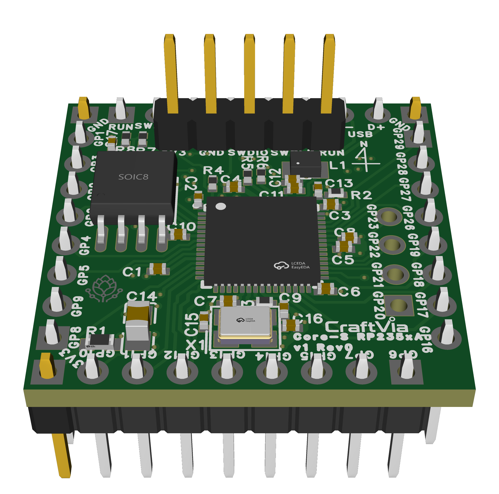

# CraftVia Core-S RP235xA

> [!WARNING]
> **未検証のRev0ハードウェアです**
>
> 凍結済み設計ですが、電気的な実機検証は完了していません。製造・実装は自己責任となり、今後のRevisionで設計が変更される可能性があります。

[English](README.md) · [CraftVia](https://craftvia.org/ja/) · [Rev0リリースノート（英語正本）](RELEASE_NOTES.md)

*Rev0 CADレンダリング — [表面](docs/images/2D_PCB1_front_2026-11-04.png) · [裏面](docs/images/2D_PCB1_back_2026-11-04.png)。画像は説明用であり、凍結済みEasyEDAソースとGerberを正とします。*

CraftVia Core-S RP235xAは、Raspberry Pi RP2354AまたはRP2350Aを搭載できるCore-S v1実装です。標準構成は内部2 MB Flashを持つRP2354A、代替構成は外付け16 MB QSPI Flashを使用するRP2350Aです。

## 現在の状態

| 項目 | 状態 |
| --- | --- |
| 製品Version | v1 |
| PCB Revision | Rev0 |
| 設計 | 初回Prototype製造向けに凍結済み |
| 実機検証 | 未完了 |
| Release tag | `v1-rev0`を予定 |

## Rev0概要

- MCU: 標準RP2354A、代替RP2350A、QFN-60
- CPU: Dual Arm Cortex-M33またはDual Hazard3 RISC-V、最大150 MHz
- SRAM: 520 KiB
- Flash: RP2354A内部2 MB、またはRP2350A + 外付けW25Q128JVSIQ 16 MB
- PCB: 25.4 mm × 25.4 mm、4層
- 電源: 安定化済み3.3 V入力
- Debug/Recovery: SWD、RUN、USB BOOTSEL
- USB: N7/N8にNative USB 1.1
- GPIO: Core-S共通端子へ26本、製品固有J8へ4本
- CAD: EasyEDA

共通要件は[CraftVia共通ドキュメント](https://github.com/craftvia/craftvia-docs)を正とします。製品固有の内容はRev0の[仕様書](docs/specification-v1-rev0.ja.md)と[検証計画](docs/verification-plan-v1-rev0.ja.md)を参照してください。

## 製造上の重要事項

- PCB製造正本は `fabrication/Gerber_PCB1_2026-11-04.zip` です。
- CPLは未Filterです。Turnkey実装へ使用する前にMCU variant別BOM/CPLを作成してください。
- RP2354A構成とRP2350A外付けFlash構成を混在させないでください。
- 指定4層Stack-up、USB差動Impedance、QFN exposed padの実装方法を確認してください。
- 発注前に `SHA256SUMS.txt` で凍結済み製造ファイルを照合してください。

## ライセンスとブランド

個別表示がない限り、ハードウェア設計ファイルは[CERN-OHL-P-2.0](LICENSE)で提供します。区分は[CraftVia Licensing](LICENSES/README.md)を参照してください。CraftViaの名称とロゴはハードウェアライセンスの対象外です。[Trademark Policy](LICENSES/TRADEMARK_POLICY.md)に従い、改変品や第三者製造品を公式CraftVia製品として表示しないでください。
