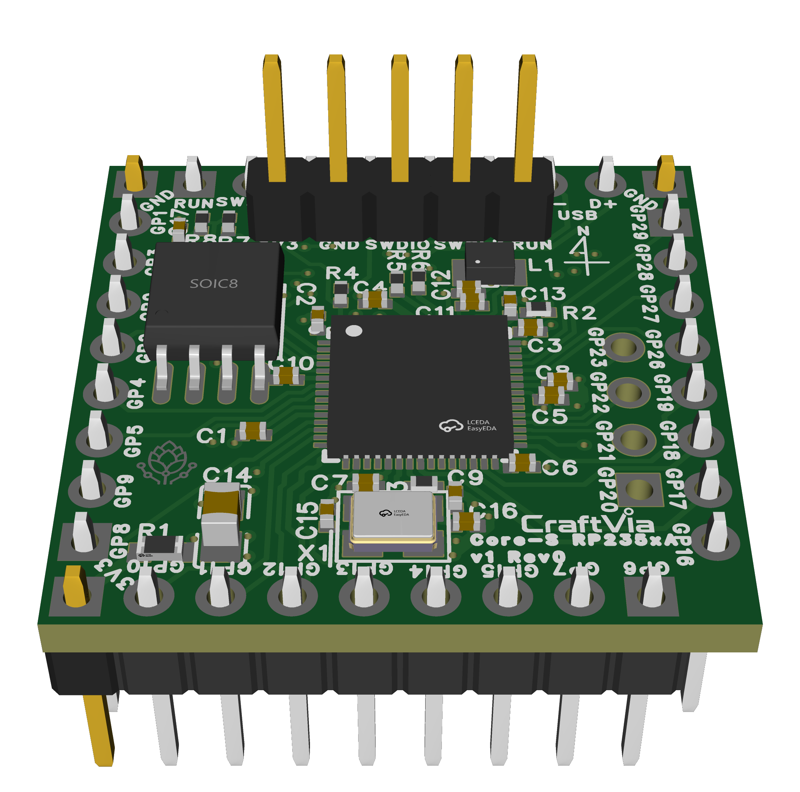

# CraftVia Core-S RP235xA

> [!WARNING]
> **Unverified Rev0 hardware**
>
> Rev0 PCBs have been ordered and are awaiting delivery. They have not yet been assembled, powered, or electrically verified. Assembly and use are at your own risk, and a later revision may change the design.

[日本語](README.ja.md) · [CraftVia](https://craftvia.org) · [Rev0 release notes](RELEASE_NOTES.md)



*Rev0 CAD rendering — [front](docs/images/2D_PCB1_front_2026-11-04.png) · [back](docs/images/2D_PCB1_back_2026-11-04.png). Images are illustrative; the frozen EasyEDA source and Gerber package are authoritative.*

CraftVia Core-S RP235xA is a dual-variant Core-S v1 implementation for the Raspberry Pi RP2354A or RP2350A. The default variant uses an RP2354A with internal 2 MB Flash; an alternate population supports an RP2350A with external 16 MB QSPI Flash.

## Current status

| Item | Status |
| --- | --- |
| Product generation | v1 |
| PCB revision | Rev0 |
| Design | Frozen for initial prototype fabrication |
| PCB fabrication | Ordered; awaiting delivery |
| Assembly | Not started |
| Hardware verification | Not started |
| Release tag | `v1-rev0` planned |

## Rev0 summary

- MCU: RP2354A by default; RP2350A alternate population, QFN-60
- CPU: dual Arm Cortex-M33 or dual Hazard3 RISC-V, up to 150 MHz
- SRAM: 520 KiB
- Flash: internal 2 MB (RP2354A) or external 16 MB W25Q128JVSIQ (RP2350A)
- PCB: 25.4 mm × 25.4 mm, 4 layers
- Supply: regulated 3.3 V input
- Debug and recovery: SWD, RUN, USB BOOTSEL
- USB: native USB 1.1 on N7/N8
- GPIO: 26 on the Core-S interface plus four product-specific signals on J8
- CAD source: EasyEDA

The common mechanical and electrical requirements are maintained in the [CraftVia common documentation](https://github.com/craftvia/craftvia-docs). Product-specific behavior and acceptance testing are described in the Rev0 [specification](docs/specification-v1-rev0.md) and [verification plan](docs/verification-plan-v1-rev0.md).

## Repository layout

```text
source/          Authoritative editable EasyEDA sources
fabrication/     Canonical Gerber package
assembly/        BOM, unfiltered CPL, and assembly reference
docs/            Schematic, images, specification, and verification plan
product.json     Machine-readable public product metadata
RELEASE_NOTES.md Detailed frozen-release record
SHA256SUMS.txt   Integrity manifest for frozen manufacturing assets
```

## Important manufacturing notes

- Use `fabrication/Gerber_PCB1_2026-11-04.zip` as the PCB fabrication master.
- The exported CPL is unfiltered. Create variant-specific BOM/CPL files before any turnkey assembly order.
- Do not mix the RP2354A population with the RP2350A external-Flash population.
- Verify the documented four-layer stack-up, USB differential impedance, and QFN exposed-pad assembly process.
- Verify frozen manufacturing files against `SHA256SUMS.txt` before ordering.

## License and brand

Hardware design files are licensed under [CERN-OHL-P-2.0](LICENSE), unless a file-specific notice says otherwise. Documentation and software category boundaries are described in [CraftVia Licensing](LICENSES/README.md).

The CraftVia name and logos are not licensed under the hardware license. See the [CraftVia Trademark Policy](LICENSES/TRADEMARK_POLICY.md). Modified or third-party-manufactured hardware must not be presented as an official CraftVia product.
